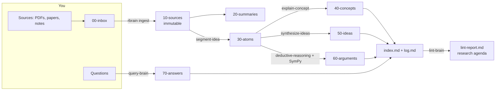

# research-brain

A **research-focused second brain** built on Obsidian and an LLM — a local model through
Ollama or LM Studio, Claude (with your Pro/Max subscription, the API, or Claude Code as an
agent), DeepSeek, or other providers (OpenRouter, Gemini, Groq, Mistral, OpenAI, LiteLLM). It implements Andrej Karpathy's *LLM wiki* pattern and adds four research
skills that a plain note-taking setup lacks:

| Skill | Question it answers | Output |
|---|---|---|
| **Idea segmentation** | *What exactly does this text claim, assume and leave open?* | typed atomic notes linked to evidence |
| **Constructing new ideas** | *What new, testable idea follows from combining what I know?* | scored hypotheses with parents and a test |
| **Explaining concepts** | *Do I (and my students) really understand this?* | layered concept pages with self-tests |
| **Deductive reasoning** | *Does this conclusion actually follow — and what am I assuming?* | arguments checked symbolically by SymPy |

On top of them sits a **RAG layer**: every note and the full text of every source is
indexed passage by passage (hybrid keyword + semantic search), so you can ask questions —
or chat — and get answers whose citations link to the exact section or PDF page.

The knowledge lives in plain Markdown that you own. The LLM does the bookkeeping
(summaries, links, index, log); you curate sources, ask questions and decide what matters.

---

## Contents
1. [How it works](#1-how-it-works)
2. [Installation](#2-installation)
3. [Connecting models](#3-connecting-models)
4. [Usage examples](#4-usage-examples)
5. [Using it from Claude Code (agent mode)](#5-using-it-from-claude-code-agent-mode)
6. [Using it inside Obsidian](#6-using-it-inside-obsidian)
7. [Command reference](#7-command-reference)
8. [Troubleshooting](#8-troubleshooting)
9. [Project layout and credits](#9-project-layout-and-credits)

Deeper documentation: [`docs/SKILLS.md`](docs/SKILLS.md) (the skills and how to apply
them), [`docs/RAG.md`](docs/RAG.md) (how retrieval and cited answers work),
[`docs/CONNECTIONS.md`](docs/CONNECTIONS.md) (every way to connect a model),
[`docs/WORKFLOWS.md`](docs/WORKFLOWS.md) (daily, weekly and paper-writing routines),
[`docs/OBSIDIAN.md`](docs/OBSIDIAN.md) (plugins and settings).

---

## 1. How it works



Three layers, as in Karpathy's pattern: **raw sources** (immutable), **the wiki** (notes the
LLM writes and maintains), and **the schema** (`CLAUDE.md` / `AGENTS.md`, which tells any
agent how the vault is organised).

**One skill definition, two runtimes.** Every skill is an [Agent Skill](https://agentskills.io)
folder (`SKILL.md` + `schema.json`) that is copied into the vault at `.claude/skills/`:

- **Claude Code** reads the whole `SKILL.md` and writes the notes itself, calling the
  `rbrain` CLI for exact operations (search, logic check, index).
- **The `rbrain` CLI** sends the model-facing part of the same `SKILL.md` to *any* model
  and asks only for a JSON object; Python then renders the notes, links, index and log.
  This is what makes 4–14B local models reliable: they fill content, code handles structure.

**Why a symbolic checker?** LLMs are good at turning prose into premises and bad at
*guaranteeing* that a conclusion follows. The deductive skill therefore lets the model
formalise the argument, lets SymPy decide validity, feeds a counter-model back when the
argument is invalid, and records the missing premise (generate → verify → revise).

---

## 2. Installation

Tested on Ubuntu 24.04 / 26.04 and WSL2 (macOS works the same way). Everything is installed
with [uv](https://docs.astral.sh/uv/), which also provides the Python interpreter, so no
system `python3-venv` is needed. Disk: ~10 GB if you use a 7B local model plus embeddings.

### 2.1 One-command install

```bash
git clone https://github.com/abelalv/research-brain.git   # or unzip the archive
cd research-brain
bash install.sh                  # vault in ~/ResearchBrain; asks before each change
bash install.sh --with-mcp       # optional: MCP server, so Claude Code/Desktop can use the RAG
bash install.sh --with-chroma    # optional: ChromaDB as the RAG vector store
bash install.sh --with-litellm   # optional: LiteLLM gateway (Bedrock, Vertex AI, Azure, ...)
bash install.sh --yes            # non-interactive, accepts every default
```

What the script does, in order:

1. **uv** — reuses it if it is already installed; otherwise installs it with the official
   script (no sudo, into `~/.local/bin`).
2. **research-brain** — `uv tool install --editable`, so `rbrain` is on your PATH and edits to
   the code or skills in the repository take effect immediately.
3. **Ollama — detected before anything is installed.** It checks, in this order: a server
   already answering at `OLLAMA_HOST` / `localhost:11434` (this also covers Ollama for Windows
   seen from WSL), an installed binary that is only stopped (it offers to start it), an
   Ollama installed on the Windows side but unreachable (it explains how to reach it instead
   of installing a second copy), a snap package. Only if nothing is found does it offer the
   official installer.
4. **Vault** — created, or completed if it already exists (notes and config are never
   overwritten).
5. **Models** — shows the models you already have and lets you pick the default from them
   (no download); then pulls only what the vault still lacks, typically the `bge-m3`
   embedding model.
6. **Other connections** (optional) — Claude Code, and the `rbrain connect` wizard for Claude,
   DeepSeek, OpenRouter, Gemini, Groq, Mistral, OpenAI, Together, LM Studio or LiteLLM.

It ends with `rbrain doctor`. Uninstall with `uv tool uninstall research-brain` (the vault is
never touched).

### 2.2 Manual install with uv

```bash
curl -LsSf https://astral.sh/uv/install.sh | sh          # if uv is missing
cd research-brain
uv tool install --editable .                              # puts `rbrain` in ~/.local/bin
# uv tool install --editable . --with 'litellm!=1.82.7,!=1.82.8'   # with LiteLLM
rbrain --version
rbrain init ~/ResearchBrain
rbrain ollama            # is Ollama running? which models do you have? which are missing?
rbrain connect           # choose and test your models (wizard)
rbrain doctor
```

For development (tests, editing the package), uv creates a project environment from the
lock file:

```bash
uv sync                  # .venv with the exact versions in uv.lock
uv run pytest -q         # 92 tests
uv run rbrain --help
```

`pip install -e .` also works if you prefer pip.

### 2.3 Obsidian and Claude Code

**Obsidian**: download from <https://obsidian.md/download> (AppImage or `.deb`) or
`flatpak install flathub md.obsidian.Obsidian`; then *Open folder as vault* →
`~/ResearchBrain`, and install the **Dataview** community plugin so `Dashboard.md` works
(details in [`docs/OBSIDIAN.md`](docs/OBSIDIAN.md)).

**Claude Code** (optional — for agent mode, and to use Claude with your subscription):

```bash
curl -fsSL https://claude.ai/install.sh | bash     # native installer (macOS, Linux, WSL)
claude                                              # log in once
```

Claude Code requires a Pro, Max, Team, Enterprise or Console account.

### 2.4 Try it without any model

`examples/demo.sh` builds a full vault from canned responses (no LLM needed), so you can see
every kind of note in Obsidian before configuring models:

```bash
bash examples/demo.sh ~/rbrain-demo    # then open ~/rbrain-demo in Obsidian
```

---

## 3. Connecting models

Run the wizard; it shows what is already available, asks for a key only if one is missing,
lists the provider's current models, tests the connection and saves a named profile:

```bash
rbrain connect                 # interactive menu
rbrain connect --list          # configured profiles and their status
```

Each profile can be the **default**, be assigned to **specific skills**, or stay **on
demand** (`rbrain --profile NAME ...`). Typical setups:

```bash
# A — everything local (private, free)
rbrain connect ollama --name local --default

# B — local for bulk work, Claude (your Pro/Max subscription, no API key) where quality matters
rbrain connect claude_code --skills synthesize-ideas,deductive-reasoning

# C — hybrid: local embeddings + DeepSeek generation
rbrain connect deepseek --default
rbrain connect ollama --model bge-m3 --embeddings

# D — one command with another model
rbrain --profile claude synthesize -q "graph neural networks for epidemics"
```

| Ways to connect | Providers |
|---|---|
| Local servers | `ollama`, `lmstudio`, `openai_compat` (vLLM, llama.cpp, a lab GPU server) |
| Claude | `claude_code` (subscription via Claude Code, no key) · `anthropic` (API key) |
| Cloud APIs | `deepseek`, `openrouter`, `gemini`, `groq`, `mistral`, `openai`, `together` |
| Gateway | `litellm` (Bedrock, Vertex AI, Azure OpenAI, Cohere and 100+ more) |
| Agent mode | `rbrain agent --backend claude \| deepseek \| ollama \| custom` |

API keys are stored outside the vault in `~/.config/research-brain/secrets.env` (mode 600).
Everything ends up in `<vault>/.rbrain/config.toml`, which you can also edit by hand.
Full details, including how the subscription connection works and agent mode with DeepSeek
or Ollama: [`docs/CONNECTIONS.md`](docs/CONNECTIONS.md).

> **Privacy.** With Ollama or LM Studio nothing leaves your machine. With any cloud
> connection, the text of the notes involved in each command is sent to that provider.

**Model sizing for local use.** On an 8 GB GPU, a 7B model (e.g. `qwen2.5:7b-instruct`)
handles segmentation, synthesis and explanation; a 14B reasoning model such as
`deepseek-r1:14b` is partially offloaded to the CPU (slower but fine) and is worth it only
for deduction. On a CPU-only laptop, use a 3–4B model with `num_ctx = 8192` and
`think = false` for hybrid thinking models.

## 4. Usage examples

The examples use the text in `examples/sources/` (PINNs for SIR inverse problems); the
`examples/fake-responses/` folder contains the exact JSON each skill returned, so you can
compare with what your model produces.

### 4.1 Ingest a paper

```bash
rbrain ingest ~/Downloads/paper.pdf          # PDF, Markdown, LaTeX, HTML or text
rbrain ingest paper.pdf --marker             # better equations/tables if Marker is installed
rbrain ingest notes.md --no-segment          # summary page only
```

```
  + 10-sources/physics-informed-neural-networks-for-estimating-transmission-rates-in-sir-models.md
  + 20-summaries/summary-physics-informed-neural-networks-for-estimating-transmission-rates-in.md
  + 30-atoms/the-sir-model-splits-a-population-into-three-compartments.md
  + 30-atoms/a-pinn-treats-the-transmission-rate-as-a-trainable-parameter.md
  + 30-atoms/reporting-rate-and-initial-infections-are-not-jointly-identifiable.md
  + 30-atoms/pinn-residuals-are-enforced-only-at-collocation-points.md
  ...
```

Each atom has a declarative title, a `kind` (definition, assumption, claim, method, result,
evidence, question, hypothesis), a confidence level, the quote it came from, links to the
atoms it depends on, and links to related notes from *other* sources found by search.

### 4.2 Segment your own thinking

```bash
rbrain segment "00-inbox/brainstorm-after-seminar.md"
rbrain segment --text "Maybe the rumour model is just a porous-medium equation on a graph; if so, finite propagation speed should appear and the inverse problem for the diffusion exponent..."
```

### 4.3 Explain a concept (and fill a missing page)

```bash
rbrain explain "physics-informed neural network"
rbrain explain "identifiability" --level undergraduate     # intro | undergraduate | graduate | expert
```

The page contains intuition, a formal definition in LaTeX, a worked example, typical
misconceptions, prerequisites and related concepts (as links), notes from the vault, and
foldable self-test questions. A `## My notes` section is yours and survives regeneration.

### 4.4 Construct new ideas

```bash
rbrain synthesize "[[a-pinn-treats-the-transmission-rate-as-a-trainable-parameter]]" \
                  "[[can-pinns-estimate-spatially-varying-transmission-on-contact-networks]]" \
                  -q "graph neural networks for spatial epidemic spread" --n 3
```

```
  + 50-ideas/graph-laplacian-residual-for-network-sir-pinns.md        (combination,  N3 F4 I4)
  + 50-ideas/learn-the-mobility-graph-from-epidemic-curves.md         (inversion,    N3 F3 I4)
  + 50-ideas/identifiability-analysis-before-pinn-training.md         (gap-filling,  N2 F5 I3)
```

Each idea states a testable proposition, its operator and parents, why it might be new
(and what search would show it is not), the smallest test that could refute it, its
assumptions and risks, calibrated scores, and a next step of at most one day.

### 4.5 Check a deductive argument

```bash
rbrain deduce \
  -p "If the residual vanishes on the whole interval and the initial conditions hold, the network solves the IVP" \
  -p "If the network solves the IVP and the IVP has a unique solution, the network equals the true trajectory" \
  -p "Training drove the residual to zero" \
  -p "The initial conditions are satisfied" \
  -g "The trained PINN equals the true SIR trajectory"
```

```
  · deductive-reasoning → ollama:deepseek-r1:14b
  · deductive-reasoning.revise → ollama:deepseek-r1:14b
  VALID: the conclusion follows from the premises.
  + 60-arguments/a-trained-pinn-equals-the-true-sir-trajectory.md
```

The note records what happened: round 0 was **invalid** (counter-model `Uniq = F`), the
model proposed the missing premise "the SIR IVP has a unique solution" (justified by
Picard–Lindelöf), round 1 was **valid** — and the soundness section still flags premise P3
as questionable, because the residual is only enforced at collocation points. Premises can
also be notes: `-p "[[pinn-residuals-are-enforced-only-at-collocation-points]]"`.

The checker also works alone, without any LLM — useful in class:

```bash
rbrain logic check "P -> Q" "Q" --goal "P"        # INVALID, counter-model P=F, Q=T
rbrain logic table "(P -> Q) <-> (~Q -> ~P)"      # truth table: tautology
rbrain logic classify "(P & (P -> Q)) -> Q"
```

### 4.6 Ask the brain (RAG) and let answers compound

```bash
rbrain ask "What are the main limitations of PINNs for estimating epidemic parameters?" --save
rbrain ask "¿Qué parámetros no son identificables?" --expand        # Spanish question, English notes
rbrain ask "What value of beta did the experiment use?" --scope sources --show-context
rbrain chat                                                          # follow-up questions
rbrain rag search "collocation points" -k 5 --full                   # just look at the passages
```

```
  · query-brain → ollama:qwen2.5:7b-instruct-q4_K_M (8 passages from 5 notes, 4,731 characters)

First, a PINN only penalises the ODE residual at a finite set of collocation points, so a small
training loss does not imply that the trajectory satisfies the SIR equations everywhere
([[physics-informed-neural-networks-for-estimating-transmission-rates-in-sir-models#4. Limitations|S1]]). …

## Sources
- **S1** [[physics-informed-neural-networks-…#4. Limitations|Physics-informed neural networks … › 4. Limitations]]
…
  context: 8 passages from 5 notes, 4,731 characters · cited passages: 5 · groundedness: 67%
```

Passages come from your notes **and** from the full text of the sources; each citation links
to the section or PDF page it came from; invented citations are flagged, and the
groundedness score tells you how much of the answer is backed by passages. With `--save`
the answer is filed in `70-answers/` and becomes retrievable itself. How it works and how to
tune it: [`docs/RAG.md`](docs/RAG.md).

### 4.7 Keep the vault healthy and get a research agenda

```bash
rbrain lint            # missing pages, orphans, duplicates, unsourced claims, invalid arguments
rbrain lint --llm      # + suggested research questions and kinds of sources to look for
rbrain index --embed   # rebuild index.md and the embedding cache
rbrain search "identifiability reporting rate" -k 5 --type atom
```

---

## 5. Using it from Claude Code (agent mode)

```bash
rbrain agent                                  # Claude Code in the vault, with your Claude login
rbrain agent --backend deepseek               # same agent, DeepSeek model (Anthropic-compatible API)
rbrain agent --backend ollama --model <model> # same agent, local model through Ollama
```

(`cd ~/ResearchBrain && claude` is equivalent to the first line.) Claude Code reads
`CLAUDE.md` (the schema) and discovers the seven skills in `.claude/skills/`. Then talk
naturally:

```text
> Ingest 00-inbox/raissi-2019.pdf and discuss the key takeaways with me before filing.
> Segment the summary of the porous-medium paper into atomic ideas.
> Combine my notes on rumour spreading and on graph Laplacians into three new ideas.
> Does "the network equals the true solution" follow from these three atoms? Check it.
> Explain "identifiability" at undergraduate level for my modelling course.
> Lint the vault and propose what I should read next.
```

Claude follows the "In Claude Code" section of each skill: it writes the notes itself, and
calls `rbrain search`, `rbrain logic check` and `rbrain index` for the exact parts. Keep
Obsidian open beside the terminal to watch the graph grow — "Obsidian is the IDE, the LLM is
the programmer, the wiki is the codebase".

Codex, OpenCode and Gemini CLI read `AGENTS.md` (identical to `CLAUDE.md`); point them to
`.claude/skills/` or copy the folders into their own skills directory.

---

## 6. Using it inside Obsidian

- **Dashboard.md** (Dataview): ideas ranked by score, arguments that need work,
  low-confidence atoms, atoms by kind, recent concepts and sources.
- **Graph view**: colour groups per note type are pre-configured (atoms blue, concepts green,
  ideas orange, arguments purple, summaries teal).
- **Templates** (core plugin) in `90-templates/`: atom, idea, concept, argument, summary,
  fleeting thought — for writing notes by hand in the same format.
- **Copilot plugin with a local model** (as in the XDA article): four prompts ship in
  `copilot-custom-prompts/` — *RB – Segment into atomic ideas*, *RB – Construct new ideas*,
  *RB – Explain concept*, *RB – Check deductive argument* — for quick interactive use on a
  selection. Setup (including the `OLLAMA_ORIGINS` CORS setting) is in
  [`docs/OBSIDIAN.md`](docs/OBSIDIAN.md).

---

## 7. Command reference

| Command | Purpose |
|---|---|
| `rbrain init PATH [--force] [--link-skills] [--no-default]` | create a vault (never overwrites unless `--force`) |
| `rbrain doctor [--live]` | check folders, skills, models, keys, embeddings (`--live`: test prompt) |
| `rbrain connect [PROVIDER] [--model M] [--name N] [--default \| --skills a,b \| --optional] [--embeddings]` | connect and test a model (wizard without arguments) |
| `rbrain connect --list` / `--test` | configured profiles and their status |
| `rbrain ollama [--pull-missing] [--pull MODEL]` | Ollama server, installed models, models the vault needs |
| `rbrain agent [--backend claude\|deepseek\|ollama\|custom] [--model M] [--print-env]` | Claude Code in the vault with that backend |
| `rbrain ingest FILE [--title T] [--no-segment] [--max-chunks N] [--marker]` | add a source |
| `rbrain segment NOTE\|FILE` / `--text "..."` | idea segmentation |
| `rbrain synthesize [NOTES...] [-q FOCUS] [--n 3]` | construct new ideas |
| `rbrain explain CONCEPT [--level L]` | layered concept page |
| `rbrain deduce -p P1 -p P2 ... -g GOAL [--rounds 2]` | deductive reasoning + symbolic check |
| `rbrain ask QUESTION [--save] [--show-context] [-k K] [--scope all\|wiki\|sources] [--expand] [--rerank]` | RAG answer with passage citations |
| `rbrain chat [--scope ...]` | RAG conversation (`/sources`, `/save`, `/scope`, `/expand`, `/rerank`, `/exit`) |
| `rbrain rag index [--rebuild]` / `rag stats` / `rag search Q [--full]` | build, inspect and query the passage index |
| `rbrain mcp [--install]` | MCP server with the vault's RAG and tools for Claude Code / Claude Desktop |
| `rbrain search QUERY [-k K] [--type T] [--keyword]` | hybrid BM25 + embedding search |
| `rbrain lint [--llm]` | health check and research agenda |
| `rbrain index [--embed]` | rebuild `index.md` (and embeddings) |
| `rbrain logic check\|table\|classify ...` | propositional logic without an LLM |
| `rbrain skills` | list skills |

Global flags: `--vault PATH` (default: the current directory if it is a vault, then
`$RBRAIN_VAULT`, then the vault created last by `rbrain init`) and `--profile NAME`.

Formula syntax: `~` (not), `&` (and), `|` (or), `->` (implies, right-associative), `<->`
(iff), parentheses; also `¬ ∧ ∨ → ↔` and the words `not and or implies iff`.

---

## 8. Troubleshooting

| Symptom | Cause and fix |
|---|---|
| `Cannot reach http://localhost:11434` | Ollama is not running: `rbrain ollama` tells you why and how to start it. On WSL with Ollama for Windows, start the Windows app or `export OLLAMA_HOST=<windows-ip>:11434`. |
| `model missing` | `rbrain ollama --pull-missing`, or pick an installed model with `rbrain connect ollama`. |
| `... API_KEY not set` | `rbrain connect <provider>` asks for it and stores it in `~/.config/research-brain/secrets.env`. |
| Claude Code profile fails with "not logged in" | Run `claude` once and log in; `rbrain doctor` shows the login method. |
| `rbrain: command not found` after install | Open a new terminal, or run `uv tool update-shell`. |
| Notes are shallow or the model ignores instructions | The context is too small. Ollama's default context is short and truncates silently; keep `num_ctx = 16384` (8192 on CPU). Reduce `chunk_chars` for small models. |
| `did not return valid JSON` | Small models sometimes fail. The CLI retries once; if it persists, use a bigger model for that skill via `[skill_profiles]`, or lower `temperature`. |
| Very slow on CPU | Use a 3–4B model, `think = false`, `num_ctx = 8192`, and `--max-chunks 3` when ingesting. |
| LaTeX looks broken in a note | Report it — the JSON repair handles single-backslash LaTeX (`\frac`, `\nabla`, `\theta`); add the command to `_LATEX_WORDS` in `llm.py` if a rare one slips through. |
| Embeddings unavailable | `ollama pull bge-m3`, or set `[embeddings] enabled = false` (keyword search still works). |
| A scanned PDF yields no text | Run OCR first (e.g. `ocrmypdf in.pdf out.pdf`) or use `--marker`. |
| An answer misses something you know is in the vault | `rbrain rag search "<question>" --full` shows what was retrieved; try `--expand`, `--scope sources` or a larger `-k` (see docs/RAG.md §8). |
| RAG index looks stale | It updates automatically; force it with `rbrain rag index` (or `--rebuild` after changing the embedding model). |
| Wrong vault is used | Pass `--vault`, or `export RBRAIN_VAULT=~/ResearchBrain`. |

---

## 9. Project layout and credits

```
research-brain/
├── install.sh                    one-command installer (uv, Ollama detection, models, connections)
├── pyproject.toml, uv.lock       package metadata and pinned versions (pyyaml, numpy, sympy, pypdf)
├── src/research_brain/
│   ├── cli.py                    rbrain command
│   ├── workflows.py              ingest, segment, synthesize, explain, deduce, ask/chat, lint
│   ├── rag.py                    RAG: chunking, incremental index, hybrid retrieval, citations
│   ├── mcp_server.py             `rbrain mcp`: RAG and tools over the Model Context Protocol
│   ├── llm.py                    clients: Ollama, OpenAI-compatible, Anthropic, Claude Code, LiteLLM, fake
│   ├── providers.py              provider registry, secrets, Ollama/Claude Code detection, model listing
│   ├── connect.py                `rbrain connect` wizard, profile checks, config editing
│   ├── agent.py                  `rbrain agent`: Claude Code with Claude, DeepSeek or Ollama
│   ├── logic.py                  propositional parser and SymPy validity checker
│   ├── search.py                 note-level BM25 + embeddings (reuses the RAG vectors)
│   ├── vault.py                  notes, frontmatter, slugs, index.md, log.md
│   ├── render.py                 deterministic Markdown for each note type
│   ├── skills/                   the seven Agent Skills (SKILL.md + JSON schemas)
│   └── vault_template/           CLAUDE.md, Dashboard, templates, Obsidian config, Copilot prompts
├── docs/                         SKILLS.md, RAG.md, CONNECTIONS.md, WORKFLOWS.md, OBSIDIAN.md
├── examples/                     demo source, canned model responses, demo.sh
└── tests/                        92 tests (uv run pytest)
```

Design sources: Andrej Karpathy's *LLM Wiki* gist (three layers; ingest, query, lint;
`index.md` and `log.md`), AgriciDaniel/claude-obsidian (skills for Claude Code + Obsidian,
immutable sources, provenance), coleam00/second-brain-skills (skills as progressive
disclosure of context), and Patrick Hearn's XDA article on Obsidian + Copilot + a local LLM
(custom prompts and privacy). This project's own contribution is the research layer: the
four research skills, the deterministic rendering for small local models, and the
generate → verify → revise loop with a symbolic checker.

License: MIT.
