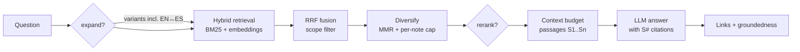

# RAG: asking questions to the whole vault

The second brain now has a **passage-level retrieval-augmented generation (RAG)** layer.
Every note *and the full text of every source* is split into passages, indexed for keyword and
semantic search, and used to answer questions with citations that link to the exact section
or PDF page.

```bash
rbrain ask "Which parameters are not identifiable in the SIR inverse problem?"
rbrain chat                                   # conversation with follow-up questions
rbrain rag search "collocation points" --scope sources --full
```

## 1. Why RAG in an LLM-wiki

Karpathy's LLM-wiki pattern argues against *pure* RAG: re-deriving knowledge from raw
chunks on every question means nothing accumulates. This system keeps the wiki — summaries,
atoms, concepts, ideas, arguments compiled once — and adds RAG on top of **two layers**:

| Layer | Scope flag | What it holds | Use it for |
|---|---|---|---|
| Wiki | `--scope wiki` | your compiled synthesis (summaries, atoms, concepts, ideas, arguments, saved answers) | "what do I think / know about X?" |
| Sources | `--scope sources` | the full extracted text of every paper and document | exact numbers, definitions, quotes, page references |
| Both | `--scope all` (default) | everything | most questions |

Saved answers (`--save`, `/save` in chat) become wiki notes, so questions compound too.

## 2. How a question is answered



**Chunking.** Notes are split into passages of about `chunk_chars` characters, following the
heading structure (a passage never mixes two sections) and the PDF pages (each extracted
page is a `## Page N` heading). Display equations `$$…$$` and code blocks are never cut.
Neighbouring passages overlap by whole paragraphs or sentences, never by a fragment of a
formula.

**Contextual headers.** Each passage is indexed together with `note title › section`, so a
short passage such as "β was recovered within 5 %" is still found by a query about "PINN
transmission rate" (a cheap, LLM-free form of contextual retrieval).

**Hybrid retrieval.** Two rankings are computed for the question (and for each query
variant): BM25 on the passage text, and cosine similarity between embeddings
(`bge-m3` through Ollama by default). They are merged with Reciprocal Rank Fusion,

$$
\mathrm{RRF}(d) \;=\; \sum_{r \in \text{rankings}} \frac{1}{60 + \operatorname{rank}_r(d)},
$$

which needs no score calibration between keyword and vector search. Without an embedding
model the system still works with BM25 alone.

**Diversification.** The final passages are chosen greedily by

$$
d^\star = \arg\max_{d}\; (1-\delta)\,\frac{\mathrm{RRF}(d)}{\max \mathrm{RRF}} \;-\; \delta \max_{d' \in S} J(d, d'),
$$

where $J$ is the word-overlap (Jaccard) similarity with passages already selected and
$\delta$ is `diversity`; at most `max_per_note` passages come from the same note. This avoids
five near-identical passages from one paper.

**Optional steps.** `--expand` asks the model for three query variants: technical synonyms,
a more specific version, and a **translation English ↔ Spanish** — keyword search alone cannot
match a Spanish question to English notes. `--rerank` asks the model to score the candidates
0–3 and keeps the best; both cost one extra LLM call.

**Context budget.** Passages are numbered `[S1] … [Sn]` and added until `max_context_chars`.
Oversized passages are *clipped*, not silently dropped (a classic cause of "the vault has no
information" while the evidence was retrieved). Every answer reports what was sent:
`context: 8 passages from 5 notes, 4,731 characters`.

**Grounded citations.** The model must cite `[S#]` after every factual sentence. The CLI then
turns each marker into a clickable Obsidian link — `([[paper#4. Limitations|S1]])` or
`([[paper#Page 7|S3]])` — adds a **Sources** list, flags invented ids (`S9⚠`), and computes a
**groundedness** score: the share of substantive sentences carrying a valid citation. A low
score is a signal to check the answer, not to trust it.

## 3. Commands

```bash
rbrain rag index                 # incremental: only new or edited notes are (re)embedded
rbrain rag index --rebuild       # after changing chunk size or the embedding model
rbrain rag stats                 # passages per note type, model, backend, dimension
rbrain rag search "question" [-k 8] [--scope all|wiki|sources] [--expand] [--rerank] [--full]

rbrain ask "question" [--save] [--show-context] [-k 8] [--scope ...] [--expand] [--rerank]
rbrain chat [--scope ...]        # /sources /save /scope wiki /expand /rerank /clear /exit
```

The index updates itself before each question and after every command that writes notes
(`auto_update = true`), so `rbrain rag index` is only needed after editing many notes by hand
or to warm the index right after installation.

In **chat**, follow-ups such as "and on graphs?" are first rewritten into a standalone
question ("How could PINNs estimate transmission rates on contact networks?") so retrieval
works; the previous turns are shown to the model only to understand the question, and
citations always point to passages.

The other skills use the same retrieval: `explain` grounds concept pages in passages from your
notes and sources, and `deduce` uses passages to judge whether premises are supported.

## 4. Configuration (`[rag]` in `.rbrain/config.toml`)

| Key | Default | Meaning |
|---|---|---|
| `backend` | `numpy` | `numpy` (no extra dependency) or `chroma` (ChromaDB) |
| `chunk_chars` | 1200 | passage size in characters (≈ 300 tokens) |
| `overlap_chars` | 200 | overlap between neighbouring passages |
| `top_k` | 8 | passages given to the model |
| `scope` | `all` | default scope for `ask` / `chat` |
| `max_context_chars` | 12000 | passage budget in the prompt (≈ 3k tokens) |
| `max_per_note` | 3 | cap of passages from one note |
| `diversity` | 0.3 | 0 = pure relevance; higher = less redundancy |
| `auto_update` | true | re-index changed notes automatically |
| `expand_queries` | false | multi-query by default (incl. EN↔ES) |
| `rerank` | false | LLM reranking by default |

The embedding model is the one in `[embeddings]`. Changing it, or the chunk settings,
triggers a full re-index automatically (the index records the settings it was built with).

**Sizing tips.** With a 7B local model and `num_ctx = 16384`, keep `max_context_chars` around
12000. With DeepSeek or Claude you can raise it to 40000–80000 and `top_k` to 15–20. For
papers with long derivations, `chunk_chars = 1600` keeps more of a proof together; for short
atomic notes the default is fine.

## 5. Embedding models

| Model | Where | Notes |
|---|---|---|
| `bge-m3` (default) | Ollama | multilingual (English + Spanish in the same space), 1024 dimensions, ~1.2 GB |
| `nomic-embed-text` | Ollama | lighter and fast on CPU; the `search_query:` / `search_document:` prefixes it needs are added automatically |
| `qwen3-embedding`, `embeddinggemma` | Ollama | alternatives if you already have them |
| cloud embeddings | OpenAI, Mistral, Gemini, Together | `rbrain connect <provider> --embeddings` (then passages are sent to that provider) |

```bash
rbrain connect ollama --model bge-m3 --embeddings   # choose / test the embedding model
rbrain rag index --rebuild
```

## 6. Storage, scale and privacy

The index lives in `<vault>/.rbrain/rag/`: `chunks.jsonl` (passages and metadata),
`manifest.json` (a hash per note, to re-embed only what changed) and `vectors.npy`
(float32 matrix) — or a `chroma/` folder with the ChromaDB backend. Brute-force cosine over
NumPy is fast up to around $10^5$ passages (a thousand papers is roughly $5\times10^4$),
so ChromaDB is optional: use it if you already rely on it (`bash install.sh --with-chroma`,
then `backend = "chroma"`). The index is a cache: it is excluded from git and rebuilt with
`rbrain rag index --rebuild`. With Ollama embeddings and a local model, nothing leaves your
machine.

## 7. RAG for Claude Code and Claude Desktop (MCP)

```bash
bash install.sh --with-mcp      # or: uv tool install --editable . --with mcp
rbrain mcp --install            # writes <vault>/.mcp.json; Claude Code asks to approve it once
# user-wide instead:  claude mcp add research-brain -- rbrain --vault ~/ResearchBrain mcp
```

The MCP server exposes `search_passages`, `search_notes`, `read_note`, `vault_index`,
`logic_check` and `refresh`. In agent mode (`rbrain agent`), Claude Code then retrieves
passages as a native tool instead of reading files one by one, and cites them as
`[[note#Heading]]`. Claude Desktop can use the same server through its MCP configuration.

## 8. When an answer is weak

1. Look at what was retrieved: `rbrain rag search "<question>" --full` or
   `rbrain ask ... --show-context`. If the right passage is not there, it is a retrieval
   problem; if it is there, it is a generation problem.
2. Retrieval problems: try `--expand` (especially for Spanish questions over English notes),
   `--scope sources` for facts from papers, a larger `-k`, or an embedding model better suited
   to your language.
3. Generation problems: use a stronger model for `query-brain`
   (`rbrain connect claude_code --skills query-brain`), or `--rerank` to put the best
   passages first.
4. Poor PDF text (broken equations, merged columns): re-ingest with `--marker`; scanned PDFs
   need OCR first (`ocrmypdf`). Figures and images are not indexed.
